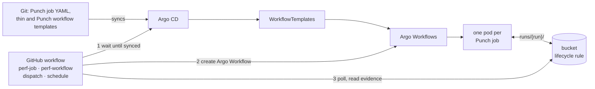
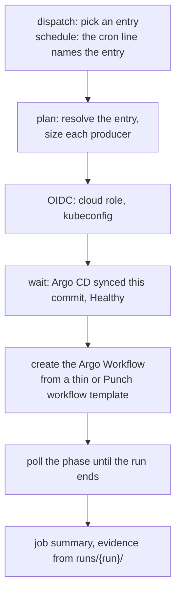
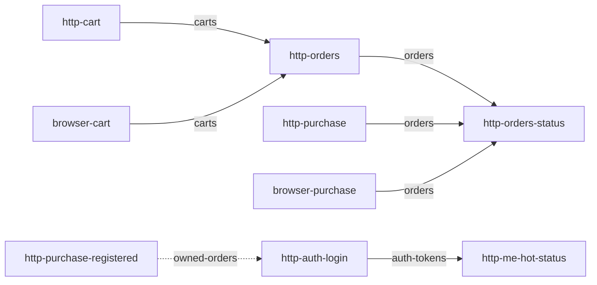
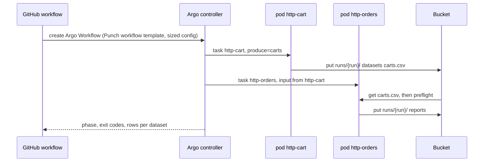

# Punch: local orchestrator to Kubernetes

This guide maps each `punch run` step to Argo Workflows and sets the target
CI design. In it, a GitHub workflow submits one Punch job, or one Punch
workflow (an ordered sequence of Punch jobs), to Argo Workflows. Argo CD
keeps the templates in step with Git, and a bucket keeps each run's artifacts
for a fixed time. The step contract, parameters, and commands are in
[`k8s/README.md`](../../k8s/README.md), and the decision is
[ADR 0006](../decisions/0006-kubernetes-runtime.md). The path from a laptop
to GitHub Actions that comes before this one is in the
[reference architecture, section 9](reference-architecture-and-implementation-guide.md#9-from-a-laptop-to-github-actions).

The terms follow [ADR 0007](../decisions/0007-job-terminology.md).

Status words: **built** (exists and has run), **design** (how it must work,
not built), **no** (not possible; the reason is given).

## Target design

Rules every part follows:

1. The Punch job YAML is the only definition. Thin templates, Punch workflow
   templates, and the GitHub dropdowns derive from the YAML files, and tests
   fail CI when they drift
   ([mapping](../../k8s/README.md#from-a-job-yaml-to-a-thin-template)).
2. Every step keeps one contract: validate, preflight, run, harvest, publish
   atomically.
3. Datasets pass between Punch jobs only inside one Argo Workflow. A
   consuming job runs only as a later step of a Punch workflow; no run reads
   data that an earlier run left behind.
4. Every artifact lives under `runs/<run>/`, and one bucket lifecycle rule
   gives it a fixed lifetime.
5. Templates reach the cluster only from Git, through Argo CD. CI creates
   Argo Workflows and never applies manifests.
6. Pods and CI jobs reach the cloud through workload identity or OIDC. Git
   holds no keys.

## Terms and names

| Term | Is | Named |
| --- | --- | --- |
| Punch job | One job YAML (`kind: K6Job`), one k6 run | `metadata.name` |
| Punch workflow | Punch jobs linked by datasets, run in order in one Argo Workflow | `<first>-to-<last>` |
| Step | A Punch job's place in a Punch workflow | the Punch job's name |
| WorkflowTemplate | Argo's stored definition: thin (one Punch job) or a Punch workflow template | the Punch job or Punch workflow name |
| Argo Workflow | One run in the cluster | `generateName: <template>-` |
| GitHub workflow | One file under `.github/workflows/` | the consumer's, such as `perf-job.yml`, `perf-workflow.yml` |
| GitHub job | One job of a GitHub workflow run; it runs one Punch job or one Punch workflow | its job id |

Rules for names (design):

- A Punch job travels as the template parameter `job`. A bare "workflow" means Argo's or GitHub's, as in
  `{{workflow.name}}` or `github.workflow`; a sequence of jobs is always a
  "Punch workflow".
- Argo rejects Workflow and WorkflowTemplate names over 63 characters and
  CronWorkflow names over 52 ([validation][argo-names]). `generateName` adds
  6 characters, so a Punch job or Punch workflow name stays at 57 or fewer. The
  Punch loader accepts 64 today.
- The `punch-` prefix belongs to Punch's own templates (`punch-k6-run`).
- Runs are selected by a label set at submit time, never by name prefix:
  `http-orders-` also matches `http-orders-status-…`.
- Argo expression tags (`{{= }}`) index hyphenated names, as in
  `tasks['http-cart']` ([variables][argo-vars]).
- GitHub artifact names are unique per run with `upload-artifact@v4`
  ([upload-artifact][gh-upload]), so each name carries the entry it ran.

## Step mapping

| # | `punch run` step (module) | Kubernetes equivalent | Status |
| --- | --- | --- | --- |
| 1 | Load and validate the YAML (`job`) | Thin WorkflowTemplate plus a parity test | built |
| 2 | Find each dataset's producers (`catalog`) | `requires-hint` parameter; the Punch workflow list | built; design (list) |
| 3 | Pick data sources, switch to a producer, `--data` (`data_plan`) | A Punch workflow runs the producer first, in the same Argo Workflow | no (pickers); design (Punch workflow) |
| 4 | Size a producer, `--size-for` (`sizing`) | The GitHub workflow sizes each producer for its next step before submit | design |
| 5 | Validate `--produce` (`execution`) | `k6-run.sh` step 0, exit 2; a Punch workflow sets `produce` to the dataset the next step requires | built |
| 6 | Preflight the required dataset | Input artifact, then `k6-run.sh` step 1, exit 1 | built (key `datasets/<ds>.csv`); design (`from:` the producer task) |
| 7 | Confirm the Docker run (TTY) | Creating the Argo Workflow is the consent | no TTY |
| 8 | Check `spec.environment.required` | Not checked | design |
| 9 | One `docker compose run` | One Argo step pod, bounded at 900 s | built |
| 10 | Stream output, harvest `[DATA]` (full CSV) | `k6-run.sh` harvest (plain CSV) | built |
| 11 | Publish atomically to the data directory | Output artifact, written only after every check passes | built (key `datasets/`); design (`runs/<run>/`) |
| 12 | Evidence `reports/state/punch-run.json` | Argo Workflow status plus `runs/<run>/` | built |
| 13 | Bounded cancel on SIGINT | `spec.shutdown: Stop`, `timeout: 900s` | built |

## GitHub Actions

Today a GitHub job can already run Punch with Docker Compose on its own
runner
([reference architecture, section 9](reference-architecture-and-implementation-guide.md#9-from-a-laptop-to-github-actions)).
This section is the design for the next step, where the GitHub job submits to
Kubernetes instead of running k6 itself.

Two GitHub workflows run on demand (`workflow_dispatch`) and on a schedule.
Both follow the same steps (design):

| | `perf-job.yml` | `perf-workflow.yml` |
| --- | --- | --- |
| Dropdown | Punch jobs without `requires` | Punch workflows: paths along `targets` that start at a Punch job without `requires` |
| Entries in the catalog below | 6 | 9: six of two steps, three of three |
| Argo Workflow | From the thin template, no `produce` | From the Punch workflow template; every step except the last produces the next step's dataset |

A Punch workflow template is an Argo [DAG][argo-dag], so one GitHub workflow
covers Punch workflows of any length.

The catalog, read from `targets` and `requires` (dashed: an optional
dataset):

The dropdown options are generated from this graph when a commit changes
it, and a test fails when they drift, as the parity test does for thin
templates. A scheduled run has no inputs, so each cron line maps to one
entry through `github.event.schedule` ([events][gh-events]). An Argo
[CronWorkflow][cron] that references the same templates is the alternative
to GitHub's schedule. Two runs that load the same system at once skew both
results, so one `concurrency` group per target environment serializes them.

## Punch workflow on Kubernetes

A failed producer stops the Punch workflow: the consumer task depends on it
and never starts.

Template changes a Punch workflow needs (design):

1. Thin templates read `inputs.parameters` instead of `workflow.parameters`.
   Argo binds an Argo Workflow's arguments to its entrypoint's inputs
   ([example][argo-args]), so a single run keeps working, and each task of a
   Punch workflow passes its own `config` and `produce`.
2. Thin templates declare the dataset input and expose the step's outputs,
   so a later task can take
   `from: "{{tasks.http-cart.outputs.artifacts.datasets}}"`
   ([artifacts][argo-artifacts]).
3. Outputs use per-run keys under `runs/<run>/` instead of the shared
   `datasets/` key.
4. An optional input slot carries `spec.data.optional`.
5. A sized k6 config reaches the step as a parameter that `k6-run.sh` writes
   to a file. Today `config` only names a preset in the `punch-k6-options`
   ConfigMap.

## Data lifetime

| Object | Mechanism | Status |
| --- | --- | --- |
| `runs/<run>/` in the bucket | Provider lifecycle rule on the prefix, in days | design |
| Argo Workflow objects | [`ttlStrategy.secondsAfterCompletion`][argo-cost] | design |
| Finished pods | [`podGC: OnPodCompletion`][argo-cost] | design |
| Artifacts of a deleted Argo Workflow | Kept: the lifecycle rule owns their lifetime; [`artifactGC`][argo-artifacts] would delete the evidence with the object | design |

Lifecycle rules count whole days and delete asynchronously. S3 documents a
delay between expiry and removal ([S3][s3-expire]), and Azure applies policy
changes within 24 hours ([Azure][az-lifecycle]). The gap only lengthens how
long evidence stays, because no run reads data from an earlier run.

## Current state against the design

| Design element | Today | Status |
| --- | --- | --- |
| One step contract | `punch-k6-run` and `k6-run.sh` | built |
| Templates synced from Git | Argo CD, server-side apply ([sync](../../k8s/README.md#sync-with-argo-cd)) | built |
| GitHub Actions, Compose on the runner | Punch's CI runs `./bin/punch run all` in a GitHub job ([section 9](reference-architecture-and-implementation-guide.md#9-from-a-laptop-to-github-actions)) | built |
| Single Punch job | `kubectl create` or `argo submit` from a thin template ([run](../../k8s/README.md#run-a-job)); no GitHub workflow | built (CLI); design (GitHub) |
| Punch workflow | Two Argo Workflows linked through the shared `datasets/` prefix ([Punch workflow](../../k8s/README.md#run-a-punch-workflow-through-datasets)) | built, outside the design |
| Punch workflow in one Argo Workflow | No Punch workflow template; thin templates cannot be steps | design |
| Dropdowns from the catalog | The catalog links producers to consumers; Punch lists no Punch workflows and writes no options | design |
| Per-run keys | Reports under `runs/{{workflow.name}}/`; datasets under the shared `datasets/` | built (reports); design (datasets) |
| Fixed lifetime | No lifecycle rule, `ttlStrategy`, or `podGC` | design |
| Commit-tagged images, OIDC | None; the consumer's kustomization maps images | design |
| Job terms and qualified names | Kind `K6Job`, module `punch.job`, template parameter `job`; the loader still accepts 64 characters | built (terms); design (name length) |

## Not possible as stated, and the redesign

| Item | Why | Way out |
| --- | --- | --- |
| Dropdown read from the YAML files at dispatch | Keys under `on:` take no expressions, so `choice` options are literal ([contexts][gh-contexts]) | Generate the options when the catalog changes; a test fails on drift |
| Inputs on a scheduled run | A `schedule` run carries no inputs | One cron line per entry, read from `github.event.schedule` |
| Reliable GitHub schedules | Runs can be delayed or dropped under load, run on the default branch only, and stop after 60 days without activity in a public repository ([events][gh-events]) | Accept the limits, or use a CronWorkflow synced by Argo CD; its evidence stays out of the GitHub UI |
| Thin templates as Punch workflow steps | `main` reads `workflow.parameters` and declares no inputs or outputs | Template changes 1 and 2 |
| In-run handoff on today's keys | The input key `datasets/<ds>.csv` and the output key `datasets` are shared by every run | Template change 3 |
| CI applying the kustomization | Argo CD owns the templates, so a CI apply puts the cluster out of step with Git | CI waits for the sync, then only creates Argo Workflows |
| Submitting right after a push | Until Argo CD syncs, the run uses the previous commit's templates | Wait until the Application's `status.sync.revision` equals the commit and its health is `Healthy` |
| A new image per commit without a Git change | Argo CD takes images from the kustomization in Git | Commit the tag and wait for the sync, or pass the image as a parameter, which lets any submitter run any image |
| GitHub-hosted runners against a local or private cluster | The runner has no route to the cluster API | A cluster API reachable through OIDC (EKS), or a self-hosted runner inside the network |
| `--size-for` in the cluster | Sizing needs Python and both YAML files at plan time | Size on the runner; template change 5 |
| Optional dataset in a Punch workflow | The template has one input, for `requires` | Template change 4; until then, the 2 Punch workflows through `http-purchase-registered` cannot run |
| Two required datasets | One input slot | A second slot; no Punch workflow in the catalog needs one |
| Menus, pickers, prompts | A pod or CI job has no TTY | Dropdown entries |
| Quoted CSV payloads | The shell harvester splits on commas | Keep payloads plain |
| OCI pod identity for artifacts | Argo has no OCI driver; the [S3 Compatibility API][oci-s3] signs with Customer Secret Keys | A key Secret scoped to one bucket |

## Weak points against k6 practice

These points leave the design as it is. Each names a practice the runtime
does not follow yet.

| Weak point | Recommended | Source |
| --- | --- | --- |
| The k6 pod can share nodes with the system under test | Keep 20% CPU idle on the load generator; give k6 pods their own nodes (node selector, taint) | [large tests][k6-large] |
| Step pods set no CPU or memory requests or limits | Set both; browser runs start at desktop size (the example uses 4 CPU, 8 GB) and scale down | [browser tests][k6-browser] |
| One pod per Punch job caps load at one node | k6-operator splits one test across pods (`parallelism`) and nodes (`separate: true`) | [distributed tests][k6-distributed], [TestRun][k6-testrun] |
| Results arrive only at the end (summary, HTML report) | Stream metrics during the run (`--out experimental-prometheus-rw`) and read them beside the system's metrics | [remote write][k6-prw] |
| Every step stops at 900 s | Soak tests hold load for hours to days; bound each run by its k6 config plus a margin | [soak testing][k6-soak] |
| Pods keep default network limits | Raise `net.ipv4.ip_local_port_range` (a safe sysctl, set per pod); `net.ipv4.tcp_tw_reuse` needs a kubelet allowlist | [fine-tune OS][k6-os], [sysctls][k8s-sysctl] |
| Node scale-down can evict a running step | Annotate step pods `cluster-autoscaler.kubernetes.io/safe-to-evict: "false"` | [autoscaler FAQ][ca-faq] |
| A `base-url` on a cluster Service skips ingress, TLS, and the load balancer | Aim at the entry point users reach, or report the hops the numbers leave out | n/a |

## Other clouds and open source

Per platform, three things change: the `artifact-repositories` ConfigMap,
the image mapping, and identity. `punch-k6-run`, `k6-run.sh`, and the thin
templates stay the same.

| Piece | AWS | GCP | Azure | OCI | Open, self-hosted |
| --- | --- | --- | --- | --- | --- |
| Cluster | EKS | GKE | AKS | OKE | kind, k3s, minikube |
| Registry | ECR | Artifact Registry | ACR | OCIR | [Harbor][harbor] |
| Argo artifact repo ([types][argo-repo]) | `s3` | `gcs` | `azure` | `s3` on the [S3 Compatibility API][oci-s3] | `s3` on MinIO or SeaweedFS |
| Pod identity | [IRSA][irsa] | [Workload Identity][gke-wi] | [Entra Workload ID][aks-wi] | Customer Secret Keys | key Secret |
| Fixed lifetime | [S3 Lifecycle][s3-expire] | [Object Lifecycle][gcs-lifecycle] | [Blob lifecycle][az-lifecycle] | [Object Lifecycle][oci-lifecycle] | [MinIO expiry][minio-ilm] |
| CI login | [configure-aws-credentials][gh-aws] | [auth][gh-gcp] | [Azure/login][gh-azure] | [oracle-actions][gh-oci] | n/a |

CI login uses GitHub [OIDC][gh-oidc] where the provider supports it. Only
minikube with SeaweedFS has a recorded run
([prerequisites](../../k8s/README.md#cluster-prerequisites)). The other
columns follow each provider's documentation.

## References

Punch: [`k8s/README.md`](../../k8s/README.md) ·
[ADR 0006](../decisions/0006-kubernetes-runtime.md) ·
[ADR 0007](../decisions/0007-job-terminology.md) ·
[ADR 0005](../decisions/0005-workflow-yaml-runtime.md) ·
[Reference architecture](reference-architecture-and-implementation-guide.md) ·
[Boundaries](punch-boundaries.md) ·
[Validation](../jobs/validation.md)

Stack: [k6][k6] · [Argo Workflows][argo] · [Argo CD][argocd] ·
[Argo CD hooks][argocd-hooks] · [Kustomize][kustomize] ·
[GitHub OIDC][gh-oidc]

[k6]: https://grafana.com/docs/k6/latest/
[k6-large]: https://grafana.com/docs/k6/latest/testing-guides/running-large-tests/
[k6-os]: https://grafana.com/docs/k6/latest/set-up/fine-tune-os/
[k6-distributed]: https://grafana.com/docs/k6/latest/testing-guides/running-distributed-tests/
[k6-testrun]: https://grafana.com/docs/k6/latest/set-up/set-up-distributed-k6/usage/configure-testrun-crd/
[k6-browser]: https://grafana.com/docs/k6/latest/set-up/set-up-distributed-k6/browser-tests/
[k6-prw]: https://grafana.com/docs/k6/latest/results-output/real-time/prometheus-remote-write/
[k6-soak]: https://grafana.com/docs/k6/latest/testing-guides/test-types/soak-testing/
[argo]: https://argo-workflows.readthedocs.io/en/latest/
[argo-repo]: https://argo-workflows.readthedocs.io/en/latest/configure-artifact-repository/
[argo-artifacts]: https://argo-workflows.readthedocs.io/en/latest/walk-through/artifacts/
[argo-cost]: https://argo-workflows.readthedocs.io/en/latest/cost-optimisation/
[argo-dag]: https://argo-workflows.readthedocs.io/en/latest/walk-through/dag/
[argo-vars]: https://argo-workflows.readthedocs.io/en/latest/variables/
[argo-args]: https://github.com/argoproj/argo-workflows/blob/main/examples/arguments-parameters.yaml
[argo-names]: https://github.com/argoproj/argo-workflows/blob/main/workflow/validate/validate.go
[cron]: https://argo-workflows.readthedocs.io/en/latest/cron-workflows/
[argocd]: https://argo-cd.readthedocs.io/en/stable/
[argocd-hooks]: https://argo-cd.readthedocs.io/en/stable/user-guide/sync-waves/
[kustomize]: https://kubectl.docs.kubernetes.io/references/kustomize/
[gh-oidc]: https://docs.github.com/en/actions/concepts/security/openid-connect
[gh-events]: https://docs.github.com/en/actions/reference/workflows-and-actions/events-that-trigger-workflows
[gh-contexts]: https://docs.github.com/en/actions/reference/workflows-and-actions/contexts
[gh-upload]: https://github.com/actions/upload-artifact
[gh-aws]: https://github.com/aws-actions/configure-aws-credentials
[gh-gcp]: https://github.com/google-github-actions/auth
[gh-azure]: https://github.com/Azure/login
[gh-oci]: https://github.com/oracle-actions
[irsa]: https://docs.aws.amazon.com/eks/latest/userguide/iam-roles-for-service-accounts.html
[gke-wi]: https://docs.cloud.google.com/kubernetes-engine/docs/concepts/workload-identity
[aks-wi]: https://learn.microsoft.com/en-us/azure/aks/workload-identity-overview
[s3-expire]: https://docs.aws.amazon.com/AmazonS3/latest/userguide/lifecycle-expire-general-considerations.html
[gcs-lifecycle]: https://docs.cloud.google.com/storage/docs/lifecycle
[az-lifecycle]: https://learn.microsoft.com/en-us/azure/storage/blobs/lifecycle-management-overview
[oci-s3]: https://docs.oracle.com/iaas/Content/Object/Tasks/s3compatibleapi.htm
[oci-lifecycle]: https://docs.oracle.com/en-us/iaas/Content/Object/Tasks/usinglifecyclepolicies.htm
[minio-ilm]: https://min.io/docs/minio/linux/administration/object-management/create-lifecycle-management-expiration-rule.html
[harbor]: https://goharbor.io/
[k8s-sysctl]: https://kubernetes.io/docs/tasks/administer-cluster/sysctl-cluster/
[ca-faq]: https://github.com/kubernetes/autoscaler/blob/master/cluster-autoscaler/FAQ.md
