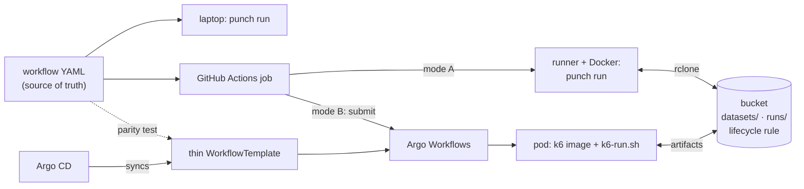
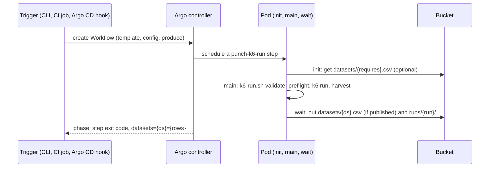
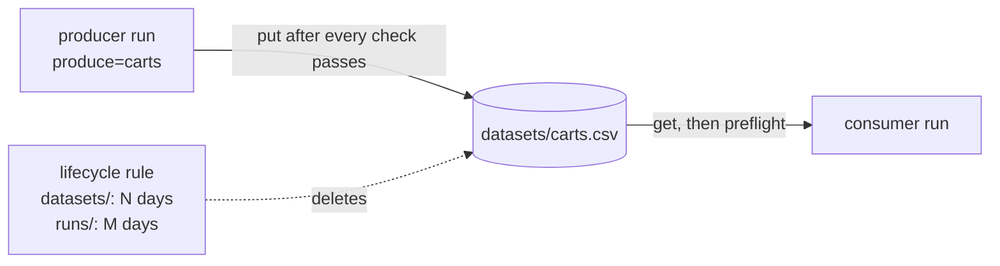

# Punch: local orchestrator to Kubernetes

This guide maps each `punch run` step to Argo Workflows. It also covers
running the same workflows from GitHub Actions and keeping datasets in a
bucket for a fixed time. The contract, parameters, and commands are in
[`k8s/README.md`](../../k8s/README.md), and the decision is
[ADR 0006](../decisions/0006-kubernetes-runtime.md).

Status words: **built** (in this repository, tested), **design** (how it must
work, not built), **no** (not possible; the reason is given).

## Target picture

Rules every runner follows:

1. The workflow YAML is the only definition. A thin template restates it
   field by field
   ([mapping](../../k8s/README.md#from-a-workflow-yaml-to-a-thin-template)),
   and a parity test fails CI when the two drift.
2. One contract: validate, preflight, run, harvest, publish atomically.
3. One bucket per environment holds `datasets/` and `runs/`. Every runner
   reads and writes the same keys.
4. A lifecycle rule gives each prefix a fixed lifetime. Consumers read
   datasets only from the bucket.
5. Pods and CI jobs reach the cloud through workload identity or OIDC. Git
   holds no keys.

## Step mapping

| # | `punch run` step (module) | Kubernetes equivalent | Status |
| --- | --- | --- | --- |
| 1 | Load and validate the YAML (`workflow`) | Thin `WorkflowTemplate` plus a parity test | built |
| 2 | Find each dataset's producers (`catalog`) | `requires-hint` parameter | built |
| 3 | Pick data sources, switch to a producer, `--data` (`data_plan`) | Explicit `produce`; chains as an Argo DAG | no (pickers), design (DAG) |
| 4 | Size a producer, `--size-for` (`sizing`) | Preset computed before submit | design |
| 5 | Validate `--produce` (`execution`) | `k6-run.sh` step 0, exit 2 | built |
| 6 | Preflight the required dataset | Input artifact `datasets/<ds>.csv`, then `k6-run.sh` step 1, exit 1 | built |
| 7 | Confirm the Docker run (TTY) | Creating the Workflow is the consent | no TTY |
| 8 | Check `spec.environment.required` | Not checked | design |
| 9 | One `docker compose run` | One Argo step pod, bounded at 900 s | built |
| 10 | Stream output, harvest `[DATA]` (full CSV) | `k6-run.sh` harvest (plain CSV) | built |
| 11 | Publish atomically to the data directory | Output artifact `datasets/`, written only after every check passes | built |
| 12 | Evidence `reports/state/punch-run.json` | Workflow status plus `runs/<run>/` | built |
| 13 | Bounded cancel on SIGINT | `spec.shutdown: Stop`, `timeout: 900s` | built |

## One run on Kubernetes

Triggers beyond the CLI follow the same path: a CI job, an Argo CD PostSync
hook (built), a [CronWorkflow][cron] for schedules, or [Argo Events][events]
for webhooks (both design).

## GitHub Actions: same workflows

Both modes run the same workflow YAML against the same bucket.

```mermaid
flowchart TB
  subgraph A["Mode A: compose runtime on the runner"]
    A1["rclone copy bucket/datasets → data dir"] --> A2["punch run wf --no-input --produce ds"]
    A2 -->|on success| A3["rclone copy data dir → bucket/datasets"]
    A3 --> A4["upload reports/ as evidence"]
  end
  subgraph B["Mode B: Argo on a cluster"]
    B1["OIDC → cloud role"] --> B2["build and push k6 image, tag = SHA"]
    B2 --> B3["kustomize edit set image, apply"]
    B3 --> B4["create Workflow, poll phase"]
    B4 --> B5["upload Workflow YAML and runs/run/"]
  end
```

| | Mode A | Mode B |
| --- | --- | --- |
| Engine | Punch compose runtime | `punch-k6-run` |
| Target reachable from | the runner | the cluster |
| Data handoff | rclone around `punch run` | Argo artifacts |
| Features | all non-interactive ones, including `--size-for` and optional datasets | per the step mapping |
| Status | design: `punch run` is built, the sync glue is not | design: [CI job](../../k8s/README.md#trigger-from-ci) |

The bucket sync is CI glue because the compose runtime reads datasets as
local files, and the engine stays standard library only outside YAML
loading and the menu ([`CLAUDE.md`](../../CLAUDE.md), rule 2).

GitHub's artifact store ([upload][gh-upload], [download][gh-download]) also
works for mode A. Its `retention-days` gives a fixed lifetime, capped by the
repository or organization limit. A consumer in another run needs the
producer's `run-id` and a token, so the bucket is the simpler shared store.

## Data lifetime

| Object | Mechanism | Unit | Status |
| --- | --- | --- | --- |
| `datasets/`, `runs/` in the bucket | Provider lifecycle rule per prefix | days | design (bucket setting) |
| Workflow objects | Argo [`ttlStrategy.secondsAfterCompletion`][argo-cost] | seconds | design |
| Finished pods | Argo [`podGC: OnPodCompletion`][argo-cost] | on completion | design |
| Run reports | Argo [`artifactGC: OnWorkflowDeletion`][argo-gc] on the `reports` output only | follows `ttlStrategy` | design |
| Two producers of one dataset | Argo [mutex][argo-sync] per dataset | n/a | design; today the last writer wins |

`artifactGC` never applies to `datasets`: the key is shared, so deleting one
Workflow would delete the file other runs read.

Expiry is not exact:

- Lifecycle rules count days on S3, GCS, Azure, and OCI.
- Deletion is asynchronous. S3 documents a delay between expiration and
  removal ([S3][s3-expire]), and Azure policy changes take up to 24 hours
  ([Azure][az-lifecycle]). A consumer can read an expired dataset during
  that gap.

Freshness therefore belongs to the consumer (design). The producer writes
`datasets/<ds>.produced-at` (epoch seconds) next to the CSV, and the
consumer's preflight fails, as it does for a missing dataset, when the file
is older than a `max-age` parameter. Object metadata cannot serve: the step
sees the downloaded file, not the object's `LastModified`.

## Not possible, and why

| Local feature | On Kubernetes or CI | Why | Way out |
| --- | --- | --- | --- |
| Menu, pickers, prompts | no | a pod or CI job has no TTY | pass `produce` and `config` |
| Producer switch on missing data | no inside one step | a step cannot start other Workflows | Argo [DAG][argo-dag] producer → consumer (design) |
| `--size-for` in the cluster | no | sizing needs Python and both YAMLs at plan time | compute a preset in CI before submit (design) |
| Two required datasets | no today | the template loads one file; an optional directory input failed on an empty prefix | a second artifact slot (design) |
| `spec.data.optional` | no today | the template downloads only `requires` | an optional artifact slot (design) |
| Quoted CSV payloads | no | the shell harvester splits on commas | keep payloads plain |
| Exact or sub-day bucket TTL | no | lifecycle counts days and deletes asynchronously | `max-age` preflight (design) |
| Mode A against a private cluster target | no from GitHub-hosted runners | the runner has no route into the cluster | mode B, or a self-hosted runner inside the network |
| OCI pod identity for artifacts | no | Argo has no OCI driver; the [S3 Compatibility API][oci-s3] signs with Customer Secret Keys | a key Secret scoped to one bucket |

## Other clouds and open source

Per platform, three things change: the `artifact-repositories` ConfigMap,
the image mapping, and identity. `punch-k6-run`, `k6-run.sh`, and the thin
templates stay the same.

| Piece | AWS | GCP | Azure | OCI | Open, self-hosted |
| --- | --- | --- | --- | --- | --- |
| Cluster | EKS | GKE | AKS | OKE | kind, k3s, minikube |
| Registry | ECR | Artifact Registry | ACR | OCIR | [Harbor][harbor] |
| Argo artifact repo ([types][argo-repo]) | `s3` | `gcs` | `azure` | `s3` on the [S3 Compatibility API][oci-s3] | `s3` on MinIO or SeaweedFS |
| Pod identity | [IRSA][irsa] | [Workload Identity][gke-wi] | [Entra Workload ID][aks-wi] | Customer Secret Keys | key Secret |
| Fixed lifetime | [S3 Lifecycle][s3-expire] | [Object Lifecycle][gcs-lifecycle] | [Blob lifecycle][az-lifecycle] | [Object Lifecycle][oci-lifecycle] | [MinIO expiry][minio-ilm] |
| CI login | [configure-aws-credentials][gh-aws] | [auth][gh-gcp] | [Azure/login][gh-azure] | [oracle-actions][gh-oci] | n/a |

[rclone][rclone] moves datasets for mode A on all five (S3, GCS, Azure Blob,
Oracle Object Storage, and S3-compatible servers). CI login uses GitHub
[OIDC][gh-oidc] where the provider supports it.

Only minikube with SeaweedFS has a recorded run
([prerequisites](../../k8s/README.md#cluster-prerequisites)). The other
columns follow each provider's documentation.

## References

Punch: [`k8s/README.md`](../../k8s/README.md) ·
[ADR 0006](../decisions/0006-kubernetes-runtime.md) ·
[ADR 0005](../decisions/0005-workflow-yaml-runtime.md) ·
[Reference architecture](reference-architecture-and-implementation-guide.md) ·
[Boundaries](punch-boundaries.md) ·
[Validation](../workflows/validation.md)

Stack: [k6][k6] · [Argo Workflows][argo] · [Argo CD][argocd] ·
[Argo CD hooks][argocd-hooks] · [Kustomize][kustomize] ·
[GitHub OIDC][gh-oidc]

[k6]: https://grafana.com/docs/k6/latest/
[argo]: https://argo-workflows.readthedocs.io/en/latest/
[argo-repo]: https://argo-workflows.readthedocs.io/en/latest/configure-artifact-repository/
[argo-gc]: https://argo-workflows.readthedocs.io/en/latest/walk-through/artifacts/
[argo-cost]: https://argo-workflows.readthedocs.io/en/latest/cost-optimisation/
[argo-sync]: https://argo-workflows.readthedocs.io/en/latest/synchronization/
[argo-dag]: https://argo-workflows.readthedocs.io/en/latest/walk-through/dag/
[cron]: https://argo-workflows.readthedocs.io/en/latest/cron-workflows/
[events]: https://argoproj.github.io/argo-events/
[argocd]: https://argo-cd.readthedocs.io/en/stable/
[argocd-hooks]: https://argo-cd.readthedocs.io/en/stable/user-guide/sync-waves/
[kustomize]: https://kubectl.docs.kubernetes.io/references/kustomize/
[gh-oidc]: https://docs.github.com/en/actions/concepts/security/openid-connect
[gh-upload]: https://github.com/actions/upload-artifact
[gh-download]: https://github.com/actions/download-artifact
[gh-aws]: https://github.com/aws-actions/configure-aws-credentials
[gh-gcp]: https://github.com/google-github-actions/auth
[gh-azure]: https://github.com/Azure/login
[gh-oci]: https://github.com/oracle-actions
[irsa]: https://docs.aws.amazon.com/eks/latest/userguide/iam-roles-for-service-accounts.html
[gke-wi]: https://docs.cloud.google.com/kubernetes-engine/docs/concepts/workload-identity
[aks-wi]: https://learn.microsoft.com/en-us/azure/aks/workload-identity-overview
[s3-expire]: https://docs.aws.amazon.com/AmazonS3/latest/userguide/lifecycle-expire-general-considerations.html
[gcs-lifecycle]: https://docs.cloud.google.com/storage/docs/lifecycle
[az-lifecycle]: https://learn.microsoft.com/en-us/azure/storage/blobs/lifecycle-management-overview
[oci-s3]: https://docs.oracle.com/iaas/Content/Object/Tasks/s3compatibleapi.htm
[oci-lifecycle]: https://docs.oracle.com/en-us/iaas/Content/Object/Tasks/usinglifecyclepolicies.htm
[minio-ilm]: https://min.io/docs/minio/linux/administration/object-management/create-lifecycle-management-expiration-rule.html
[harbor]: https://goharbor.io/
[rclone]: https://rclone.org/
