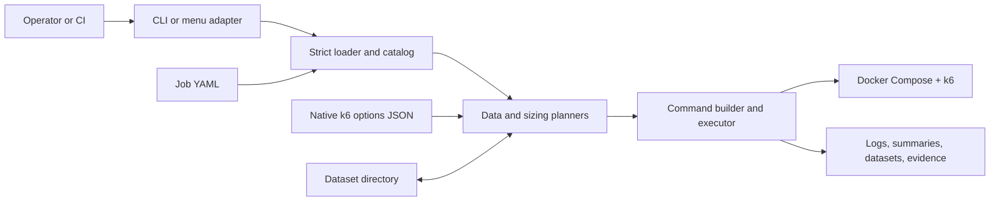

# Punch — Reference Architecture and Implementation Guide

Punch's intent is a reusable performance gate that other teams consume
without owning the pipeline internals. A consumer declares each k6 load test
as a Punch job; Punch runs every job under one contract, on a laptop, in a
GitHub Actions job, or on Kubernetes, and leaves the same kind of evidence
each time. The consumer owns its jobs and k6 scripts; Punch owns the engine.

This page explains what Punch is, why it is built this way, how a run moves
from a laptop to GitHub Actions (section 9), how a consumer migrates to the
job terms (section 10), and how to reproduce Punch's core in a restricted
environment without importing it. Source and tests (end of page) stay
authoritative. Layer ownership: [punch-boundaries.md](punch-boundaries.md).
Evidence contract: [validation.md](../workflows/validation.md).

> **Terms ([ADR 0007](../decisions/0007-job-terminology.md): accepted, not
> built).** A **Punch job** is one YAML unit and one k6 run. A **Punch
> workflow** is an ordered sequence of Punch jobs linked by datasets, and a
> **step** is a job's place in it. "Workflow" alone means a GitHub workflow
> or an Argo Workflow. This page uses those terms. Until the rename lands,
> the code, files, and YAML keep the old names (`kind: K6Workflow`,
> `punch.workflow`, `workflows/k6/`); section 10 maps each one.

## 1. Solution

Punch turns one declarative job file into one controlled run of k6: a Docker
Compose run on a laptop or a CI runner, or one Argo Workflows step on
Kubernetes. It owns the policy Compose and k6 do not:

- strict job and native k6-config loading;
- catalog-wide producer/consumer validation for datasets;
- data-source planning and producer switching;
- job and load options selected independently;
- producer sizing from a downstream job's demand;
- allow-listed environment, argument-vector command, separate streams;
- atomic dataset publication, bounded cancellation, run evidence.

Out of scope: provisioning the system under test, business scenarios,
distributed fleets, secrets, and k6 threshold evaluation.



Python is the control plane; Compose and k6 are the execution plane; approved
report, log, state, and data directories are the artifact plane. Scenarios
know nothing about orchestration.

| Component           | Module                                         | Owns                                                       |
| ------------------- | ---------------------------------------------- | ---------------------------------------------------------- |
| CLI / assembly root | [`__main__.py`](../../src/punch/__main__.py)   | Arguments, sequencing, exit codes, `punch-run.json`        |
| Menu adapter        | [`menu.py`](../../src/punch/menu.py)           | Terminal discovery, choices, confirmation                  |
| Loader              | [`workflow.py`](../../src/punch/workflow.py)   | Immutable models, strict YAML/JSON, path containment       |
| Catalog             | [`catalog.py`](../../src/punch/catalog.py)     | Cross-job dataset links and lookups                        |
| Data planner        | [`data_plan.py`](../../src/punch/data_plan.py) | Source choice and producer switching (pure)                |
| Sizing planner      | [`sizing.py`](../../src/punch/sizing.py)       | Demand normalization, sizing math, generated config (pure) |
| Executor            | [`execution.py`](../../src/punch/execution.py) | Command vector, preflight, child lifecycle, datasets       |

Adapters depend on engine modules; engine modules never import presentation.

## 2. Core contracts

**Job** (`apiVersion: punch/v1`, `kind: K6Job`; the loader accepts
`kind: K6Workflow` until the rename lands). Declarative facts only; unknown or
duplicate keys, invalid names, missing files, and paths escaping
`workingDirectory` fail at load:

```yaml
spec:
  workingDirectory: ../..
  compose: { file: docker-compose.yml, service: k6 }
  k6: { script: /scripts/orders.js, config: options/5-iterations.json }
  environment: { forward: [BASE_URL], required: [BASE_URL] }
  outputs: { summary: { path: reports/orders-summary.json } }
  data:
    directory: data
    mountedAt: /scripts/data
    produces: [{ dataset: orders, columns: [orderId], targets: [order-status] }]
    requires: [] # must exist with rows before Docker starts
    optional: [] # used only when present
  sizing: { iterationSeconds: 1.1, maxSeconds: 270, margin: 0.15 }
```

**Options.** A native k6 JSON object passed as `k6 run --config`, mounted
read-only at `/punch/k6-config.json`. A one-run `--config` replaces
`spec.k6.config`. k6 lets script options override the config, so scenarios
must not export `scenarios`, `vus`, `iterations`, `duration`, or `stages`.

**Datasets.** A name plus a fixed ordered column list. The catalog checks both
directions before any run: targets exist and consume the dataset, every
required dataset has a producer, all producers agree on columns. Producers
print `[DATA <dataset>] <csv-row>` on stdout; consumers receive
`DATA_<DATASET>_CSV=<container path>`.

**Results.** Planning and execution stay separate types:

| Type              | Holds                                                             |
| ----------------- | ----------------------------------------------------------------- |
| `DataPlan`        | Job that will actually run, chosen sources, any switch            |
| `SizingPlan`      | Target demand, margin, producer iterations/VUs, generated config  |
| `ExecutionResult` | Command, child exit code or preflight failure, dataset row counts |

A preflight failure has no child exit code; a child failure keeps its code.

## 3. Execution semantics

- **One job, one Compose run** (`run --rm`). `punch run all` runs jobs
  sequentially; a Punch workflow stays operator- or CI-controlled
  (section 9).
- **Preflight before Docker:** required environment, required data, valid
  `--produce`, output-path collisions.
- **Streams:** stdout and stderr read concurrently and forwarded to their
  matching terminal streams; both go to `reports/logs/k6-<job>.log`.
  Only tagged stdout lines are data.
- **Publication:** opt-in (`--produce <dataset>`). Rows are column-checked into
  a same-directory temp file and atomically replace the target only after a
  successful run with ≥ 1 valid row; otherwise the previous file survives.
- **Cancellation:** the child runs in its own process group; Punch first sends
  `SIGINT` to the container (`docker kill --signal=SIGINT`) so k6 can write its
  summary, then terminates and reaps within bounded time.
- **Data planning (TTY):** settle optional datasets, then for a missing
  required dataset offer catalog producers (recommended one preselected). Picking one
  switches the run to that producer, still one Compose run; Punch then names
  the consumer to run next. `--no-input` skips the pickers.
- **Evidence:** `punch run` writes `reports/state/punch-run.json` (the job's
  YAML path, config identity, data sources, sizing, results, timing, exit
  code). The menu
  reports to the terminal only. Old CSV/HTML/JSON files are not current-run
  evidence.

## 4. Options versus size-for-target

| Question         | Options selection               | Size for a target (`--size-for`)      |
| ---------------- | ------------------------------- | ------------------------------------- |
| Intent           | Load shape for the selected run | Enough rows for a later consumer      |
| Config read      | Selected job's config           | Target's config (demand input)        |
| Config executed  | That JSON as-is                 | Generated producer config             |
| Job run          | Selected job                    | Producer only; target never runs      |
| Datasets written | Operator's `--produce` choice   | Linked target datasets, automatically |

Sizing math (exact `Fraction` arithmetic; one row per iteration):

```text
shared-iterations:  Y = iterations
per-vu-iterations:  Y = vus × iterations
constant-vus:       Y = ceil(vus × durationSeconds / targetIterationSeconds)

producer iterations N = ceil(Y × (1 + targetMargin))
producer VUs        V = min(N, max(1, ceil(N × producerIterationSeconds / producerMaxSeconds)))
```

The producer runs a copy of its own config rewritten to `shared-iterations`
with `N` and `V`, keeping executor-independent scenario keys. Other executors,
staged or multi-scenario shapes, and missing sizing inputs fail before Docker.
Punch warns when produced rows fall short of `Y`.

## 5. Design decisions

| Decision                    | Why                                                  | Cost or limit                                        |
| --------------------------- | ---------------------------------------------------- | ---------------------------------------------------- |
| Declarative YAML jobs       | Workloads reviewable, consumer-owned; engine generic | Strict schema and migration discipline               |
| Native k6 JSON configs      | No second load model; configs work outside Punch     | Script options can override; needs contract tests    |
| Compose-mediated execution  | Reproducible toolchain; no host k6/Node              | Docker required; heavier startup                     |
| One job per run             | Clear cancellation, exit codes, evidence             | A Punch workflow needs repeated runs or a scheduler  |
| Filesystem catalog/datasets | Offline, inspectable, portable                       | No concurrent-writer coordination or history         |
| Pure planners               | CLI, menu, tests share one policy                    | Assembly root must keep UI out of planners           |
| Tagged stdout + atomic swap | No data service; no partial publication              | Producers follow the line protocol; low volume only  |
| Environment allow-list      | Limits secret leakage                                | Authors maintain forwarded/required names            |
| Generated sizing config     | Reproducible demand; target untouched                | Single-shape policies; assumes one row per iteration |

## 6. Reproduce independently

Build vertical slices in order; each is usable and tested before the next.
Use neutral sample jobs; keep business URLs, credentials, and data out.

| #   | Slice                 | Build                                                                                             | Accept when                                                           |
| --- | --------------------- | ------------------------------------------------------------------------------------------------- | --------------------------------------------------------------------- |
| 1   | Contracts and loader  | Immutable models, versioned schema, native-config validation, typed results, exit codes           | Bad keys, names, refs, absolute or escaping paths fail before any run |
| 2   | Catalog               | Sorted discovery; lookups: job, producers, recommended producer, sizing pairs                     | Broken links and column mismatches fail at catalog load               |
| 3   | Pure planners         | Data-source/producer switch as a state transition with a choice callback; sizing math             | Same inputs → same plan in CLI, menu, CI, tests; cycles fail typed    |
| 4   | Executor              | Argument vector, preflight, one child, concurrent streams, bounded interrupt; injectable launcher | No shell; undeclared env absent; preflight failure starts no child    |
| 5   | Dataset exchange      | Opt-in, tagged stdout only, CSV shape check, temp file beside destination, atomic swap            | Failed, empty, or malformed runs never replace valid data             |
| 6   | Adapters and evidence | Non-interactive CLI first, then a menu over the same APIs; redacted evidence record               | Child exit codes survive; evidence correlates with logs               |
| 7   | Restricted packaging  | Pinned dependencies and image digests, SBOM, checksums, schemas, offline install guide            | Install and contract suite pass with network disabled                 |

## 7. Restricted-environment hardening

- Verify dependency and image digests; fail on undeclared network access.
- Treat descriptors as code: safe YAML loading, pinned schema version, review.
- Resolve every read, mount, and write beneath an approved root.
- Never evaluate a shell string; never interpolate descriptor values.
- Secrets come from the enterprise secret mechanism, never descriptors,
  presets, command previews, logs, or evidence.
- Runner: dedicated identity, read-only inputs, bounded writable mounts,
  resource/time limits, network limited to the system under test.
- Synthetic data by default; classify, encrypt, retain, delete per policy.
- Redact evidence; integrity-protect it when it backs audit decisions.
- Interactive confirmation is usability, not authorization; CI uses
  pre-authorized identities and policy gates.

## 8. Source of truth

| Concern                              | Source                                         | Proof                                                                                                                          |
| ------------------------------------ | ---------------------------------------------- | ------------------------------------------------------------------------------------------------------------------------------ |
| Schema and path containment          | [`workflow.py`](../../src/punch/workflow.py)   | [`test_workflow.py`](../../tests/test_workflow.py)                                                                             |
| Catalog links                        | [`catalog.py`](../../src/punch/catalog.py)     | [`test_catalog.py`](../../tests/test_catalog.py)                                                                               |
| Data planning and switching          | [`data_plan.py`](../../src/punch/data_plan.py) | [`test_data_plan.py`](../../tests/test_data_plan.py)                                                                           |
| Command, streams, data, cancellation | [`execution.py`](../../src/punch/execution.py) | [`test_execution.py`](../../tests/test_execution.py)                                                                           |
| Sizing and generated config          | [`sizing.py`](../../src/punch/sizing.py)       | [`test_sizing.py`](../../tests/test_sizing.py)                                                                                 |
| Interactive selection                | [`menu.py`](../../src/punch/menu.py)           | [`test_menu.py`](../../tests/test_menu.py)                                                                                     |
| CLI sequencing and evidence          | [`__main__.py`](../../src/punch/__main__.py)   | [`test_cli.py`](../../tests/test_cli.py)                                                                                       |
| End-to-end contracts                 | —                                              | [`test_ci_contract.py`](../../tests/test_ci_contract.py), [`test_workflow_coverage.py`](../../tests/test_workflow_coverage.py) |

When prose and tested behavior disagree, fix the prose or make an explicit,
tested contract change.

## 9. From a laptop to GitHub Actions

Moving a run from a laptop to GitHub Actions changes who starts it, not what
it does. Every runtime runs one Punch job per k6 run under the same step
contract: validate, preflight, run, harvest, publish atomically. A Punch
workflow is the consumer's sequence of those runs; Punch never sequences jobs
itself.

| Runtime | Started by | One Punch job runs as | A Punch workflow runs as | Status |
| --- | --- | --- | --- | --- |
| Laptop | An operator: `punch run`, `punch menu` | One `docker compose run` | The operator runs the jobs in order; the menu can switch to a missing dataset's producer | built |
| GitHub Actions, Compose on the runner | A GitHub job that calls `punch run` | One `docker compose run` inside the GitHub job | The consumer's GitHub job runs the jobs in order | built: Punch's own CI runs `./bin/punch run all` in [`k6.yml`](../../.github/workflows/k6.yml) |
| Kubernetes from a terminal | `kubectl create` or `argo submit` from a thin template | One Argo step pod from `punch-k6-run` | Two Argo Workflows linked through the shared `datasets/` prefix | built: [k8s/README.md](../../k8s/README.md) |
| GitHub Actions submitting to Kubernetes | A GitHub job that waits for the Argo CD sync, then creates an Argo Workflow | One Argo step pod | One Argo Workflow from a Punch workflow template, one task per job | design: [orchestrator-to-kubernetes.md](orchestrator-to-kubernetes.md#github-actions) |

A GitHub job that runs Punch on its runner does what Punch's own CI does:

1. Install the pinned `requirements.txt`.
2. Build the k6 and application images (`docker compose build`), so no run
   uses scenarios baked into an older image.
3. Start the system under test and wait until it is healthy.
4. Make the report directories writable for the k6 container user.
5. Run `punch run <job>` or `punch run all`. The runner has no TTY, so data
   planning offers no pickers (section 3).
6. Upload `reports/` with `if: always()`, so a failed run keeps its evidence.

The next move keeps the same contract inside the cluster: the GitHub job
stops running k6 itself, creates an Argo Workflow from Git-synced templates,
and reads the evidence back from the run's bucket prefix
([orchestrator-to-kubernetes.md](orchestrator-to-kubernetes.md)). Menus,
pickers, and prompts stay local, because neither a GitHub job nor a pod has a
terminal.

## 10. Migrating from Punch workflows to Punch jobs

[ADR 0007](../decisions/0007-job-terminology.md) renames the YAML unit to a
Punch job. The decision is accepted and not built: every name in the "Today"
column is what Punch accepts now. Switch to the "After" column in the same
change that pins the Punch commit landing the rename. There are no aliases.

| Area | Today | After |
| --- | --- | --- |
| YAML | `apiVersion: punch/v1`, `kind: K6Workflow` | `apiVersion: punch/v1`, `kind: K6Job` |
| Loader | `punch.workflow`: `K6Workflow`, `WorkflowError`, `load_workflow` | `punch.job`: `K6Job`, `JobError`, `load_job` |
| Catalog | `punch.catalog.WorkflowCatalog`, attribute `workflows` | `punch.catalog.JobCatalog`, attribute `jobs` |
| Execution | `punch.execution.execute_workflow` | `punch.execution.execute_job` |
| Bundled files | `workflows/k6/` | `jobs/k6/` |
| CLI | `punch run <workflow>`, `punch menu [workflows-dir]` | `punch run <job>`, `punch menu [jobs-dir]`; verbs and flags unchanged |
| Run record | `reports/state/punch-run.json` key `"workflow"` | key `"job"` |
| Kubernetes | `punch-k6-run` parameter `workflow`, container variable `PUNCH_WORKFLOW` | parameter `job`, variable `PUNCH_JOB` |
| A sequence of runs | "chain" | Punch workflow; each job in it is a step |

A consumer migrates in one change, pinned to the Punch commit that lands the
rename:

1. Change `kind: K6Workflow` to `kind: K6Job` in every job file. After the
   rename, a file left behind fails with
   `kind K6Workflow was renamed to K6Job; change the kind line`.
2. Replace imports and names from the table. A missed import fails with
   `ModuleNotFoundError: No module named 'punch.workflow'`.
3. On Kubernetes, make each thin template pass `- { name: job, value: <name> }`
   instead of `workflow`, and sync the thin templates and `punch-k6-run` from
   the same commit. Argo's own `{{workflow.name}}` and
   `{{workflow.parameters.*}}` stay as they are.
4. Read `"job"` wherever you read `punch-run.json`.
5. Rename your own directories, commands, and inputs only where they say
   "workflow" for a single job; their names are yours.
6. In prose, write "job" for one YAML unit and "Punch workflow" for a
   sequence; qualify "GitHub job" and "GitHub workflow" wherever GitHub's
   terms appear nearby.

The migration is done when your tests pass, one `punch run <job>` writes
`punch-run.json` with `"passed": true` and a `"job"` key, and, on
Kubernetes, one thin template runs to `Succeeded`.
